 

**Junjia Cao · Master's student at The University of Hong Kong**

Documenting my 2026–27 learning journey through code, experiments, and projects.

[About me](#about-me) · [Selected coursework](#selected-coursework) · [Learning toolkit](#learning-toolkit)

---

## About me

I am **Junjia Cao**, a master's student at **The University of Hong Kong**. This account is my dedicated learning space for the 2026–27 academic year: a place to keep the systems I build, the experiments I run, and the lessons I take from each course.

My current work spans **artificial intelligence, deep learning, data systems, visualization, and application development**. I care about understanding how things work beneath the interface—from a database query plan to the attention mechanism inside a language model.

- **Learn the fundamentals.** Understand the model, system, or algorithm before reaching for abstractions.
- **Build and measure.** Turn concepts into working code, controlled experiments, and visible results.
- **Document the process.** Keep reproducible work and honest records of what succeeded and what did not.

## My two GitHub spaces

| Account | Purpose |
|---|---|
| **[junjiacaohku-ai — this account](https://github.com/junjiacaohku-ai)** | HKU coursework, team projects, research experiments, workshops, assignments, and learning archives |
| **[Cjj040721 — main account](https://github.com/Cjj040721)** | Independent products, iOS and PWA applications, machine-learning projects, and build-in-public work |
| **[BUFN](https://github.com/Cjj040721/BUFN) · [caojunjia.com](https://caojunjia.com)** | The writing and public narrative connecting my independent projects |

## Selected coursework

| Course | Project or collection | What I explored |
|---|---|---|
| **COMP7607** | [MemImpact](https://github.com/junjiacaohku-ai/COMP7607-Group-Project-MemImpact) | Planner-level counterfactual memory auditing for selective verification in agent systems |
| **COMP7506** | [SnapFix](https://github.com/junjiacaohku-ai/COMP7506-Group-Project-SnapFix) | AI-assisted appliance diagnosis from photos, grounded in manufacturer manuals, with guided repair workflows |
| **COMP7507** | [HK Housing Atlas](https://github.com/junjiacaohku-ai/COMP7507-Group-Project-HK-Housing-Atlas) | Interactive exploration and visual analysis of Hong Kong housing data |
| **COMP7104 / DASC7104** | [Advanced Database Assignments](https://github.com/junjiacaohku-ai/COMP7014-Assignment) | Analytical SQL, query optimisation, execution internals, transactions, and concurrency control |
| **COMP7507** | [Data Visualization Labs](https://github.com/junjiacaohku-ai/COMP7507-Lab) | Tableau, Plotly Dash, dashboard design, visual storytelling, and Gephi network analysis |
| **COMP7506** | [Smart Phone Apps Workshops](https://github.com/junjiacaohku-ai/COMP7506-WorkShop) | Android and iOS development, mobile UI, client–server systems, Flask, and SQLite |
| **Resource archive** | [HKU MSc(CompSc) Resources](https://github.com/junjiacaohku-ai/HKU-MSc-CS-Resources) | A bilingual pre-arrival archive of public course materials, projects, official documents, and application notes |

## Learning toolkit

## What I am currently exploring

- **AI systems:** agent memory, evaluation, grounding, and reliable model-assisted workflows.
- **Deep learning:** convolutional networks, Transformers, training dynamics, and reproducible experiments.
- **Data systems:** analytical queries, optimizer behavior, isolation, and concurrency.
- **Human-centred applications:** turning models and data into useful, understandable interfaces.

---

**One year at HKU. A record of things learned, built, tested, and improved.**

Learning in public · Keeping the code and the evidence together

